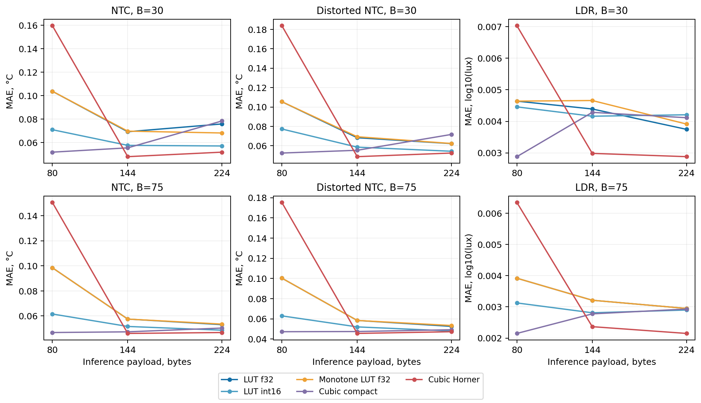
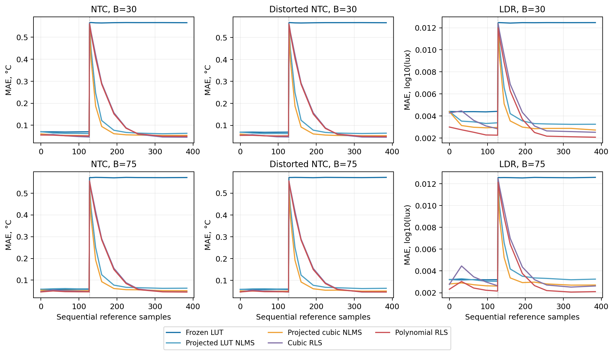

# Matched storage and sequential adaptation: new reconstruction run

All sensor observations are synthetic. New seeds and the predeclared protocol distinguish this run from the interrupted conversation. No new physical MCU measurements were made.

Static: 3312 evaluations / 144 calibration cases. Development: 3168 candidate trajectories / 144 streams. Confirmation: 3888 trajectories / 432 streams. All confirmation trajectories completed; projected coefficient-order violations: 0.

## Static error at exactly 144 bytes

| Scenario | B | LUT32 f32 | LUT60 int16 | Monotone LUT60 int16 | Compact cubic32 | Horner8 |
|---|---:|---:|---:|---:|---:|---:|
| ntc | 30 | 0.069215 | 0.057600 | 0.060253 | 0.055479 | 0.047969 |
| ntc | 75 | 0.057528 | 0.051644 | 0.051644 | 0.047347 | 0.046073 |
| ntc_frontend | 30 | 0.068330 | 0.058615 | 0.058615 | 0.055375 | 0.048804 |
| ntc_frontend | 75 | 0.058361 | 0.051985 | 0.053081 | 0.047395 | 0.045508 |
| ldr | 30 | 0.004392 | 0.004162 | 0.003848 | 0.004285 | 0.002986 |
| ldr | 75 | 0.003213 | 0.002811 | 0.002832 | 0.002776 | 0.002366 |

NTC units are °C; LDR is log10(lux). Means average repetitions within each virtual unit, then units. All seven equal-cap methods and both smaller physical/polynomial references are retained in static_summary.json; the figure includes all three predeclared caps.

The 144-byte Horner model has eight pieces fitted with eleven B-spline coefficients, then stored as 32 local polynomial coefficients. The compact cubic32 has a different function class and evaluation path. Equal payload does not imply equal degrees of freedom or execution time.

The old measured Horner model used thirteen pieces and 224 bytes. Its MCU timing cannot be assigned to this new eight-piece model. The new static sweep has no target timing measurements.

## Final error after 384 sequential references

| Scenario | B | Drift | Frozen LUT | Projected LUT NLMS | Projected cubic NLMS | Cubic RLS | Polynomial RLS |
|---|---:|---|---:|---:|---:|---:|---:|
| ntc | 30 | none | 0.070092 | 0.061564 | 0.051141 | 0.046120 | 0.050501 |
| ntc | 30 | step | 0.565739 | 0.063426 | 0.053866 | 0.045640 | 0.049691 |
| ntc | 30 | ramp | 0.565739 | 0.063764 | 0.054129 | 0.047669 | 0.051111 |
| ntc | 75 | none | 0.058579 | 0.060821 | 0.049959 | 0.046268 | 0.045572 |
| ntc | 75 | step | 0.571783 | 0.063102 | 0.051580 | 0.046353 | 0.045289 |
| ntc | 75 | ramp | 0.571783 | 0.063186 | 0.051442 | 0.048310 | 0.046790 |
| ntc_frontend | 30 | none | 0.068457 | 0.061865 | 0.049686 | 0.046129 | 0.049569 |
| ntc_frontend | 30 | step | 0.566982 | 0.064384 | 0.052874 | 0.045969 | 0.049085 |
| ntc_frontend | 30 | ramp | 0.566982 | 0.064774 | 0.053208 | 0.047893 | 0.050349 |
| ntc_frontend | 75 | none | 0.059324 | 0.061602 | 0.049255 | 0.046691 | 0.047500 |
| ntc_frontend | 75 | step | 0.572218 | 0.064115 | 0.051579 | 0.046884 | 0.047236 |
| ntc_frontend | 75 | ramp | 0.572218 | 0.064213 | 0.051458 | 0.048931 | 0.048863 |
| ldr | 30 | none | 0.004412 | 0.003151 | 0.002615 | 0.002530 | 0.002103 |
| ldr | 30 | step | 0.012469 | 0.003251 | 0.002726 | 0.002522 | 0.002075 |
| ldr | 30 | ramp | 0.012469 | 0.003256 | 0.002739 | 0.002529 | 0.002077 |
| ldr | 75 | none | 0.003218 | 0.003155 | 0.002688 | 0.002670 | 0.002153 |
| ldr | 75 | step | 0.012574 | 0.003252 | 0.002711 | 0.002623 | 0.002104 |
| ldr | 75 | ramp | 0.012574 | 0.003249 | 0.002711 | 0.002625 | 0.002115 |

The complete nine-method tables, paired unit-bootstrap intervals, and checkpoint curves are in the JSON summaries. Intervals are exploratory and unadjusted. Frozen models receive the same available stream but do not consume its labels for updates.

## Storage and interpretation

LUT32 and compact cubic32 use 144 bytes for inference. Their NLMS paths use 148 persistent bytes including eta. PAVA working storage and the Python reference implementation's temporary arrays are additional and unmeasured on MCU. Cubic32 RLS uses 4244 persistent bytes including its full covariance; polynomial RLS uses a degree-dependent larger state, up to 460 bytes. These RLS methods are stronger, larger-state references, not equal-memory algorithms.

Every method starts from an offline reference fit. The online coefficients/covariance are rounded to float32 after each sample, with float64 host intermediates. A future MCU implementation needs numerical validation and its own update-time/stack measurements. The earlier UPDATE_COST_ONLY timings are not timings of these algorithms.

The controlled stream supplies one labelled reference in every quantity bin per shuffled block. This is a recalibration experiment with reference access, not unsupervised self-calibration. Offset and nonlinear ADC drift are injected assumptions. Physical NTC accuracy, sensor aging, energy and peak stack remain unmeasured.

## Selected parameters and reproducibility

Development-only selection: `{"cubic_nlms": 0.5, "cubic_projected_nlms": 0.5, "cubic_rls": 0.98, "lut_nlms": 0.5, "lut_projected_nlms": 0.5, "poly_rls": 0.98}`.

The development seed is 2026110800; confirmation seed is 2026110801. Protocol and selected parameters were committed before confirmation. Every raw reference, static model, online prequential prediction, checkpoint model state and RLS covariance is retained. run_info.json contains commands, versions, source hashes and result hashes.

Regenerate: `python experiments/sensor_recovery/report_matched_adaptation.py experiments/sensor_recovery/results/matched_adaptation_20261108`.

