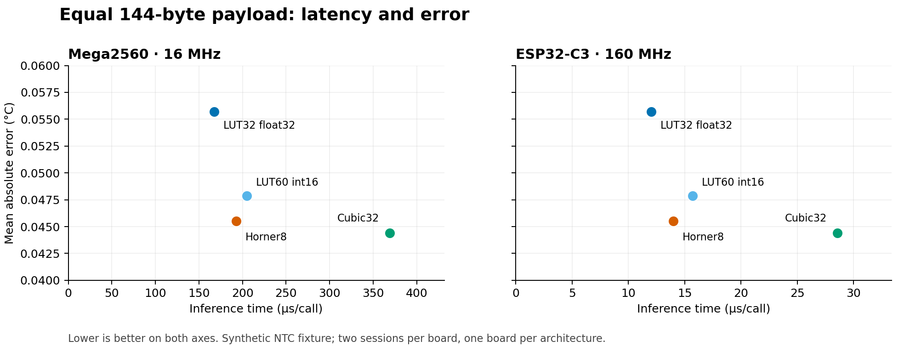
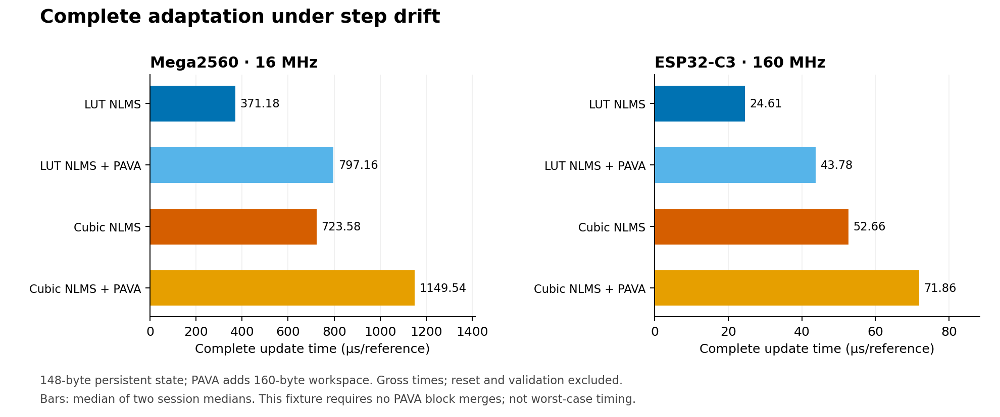

# Matched Mega2560 and ESP32-C3 results

The same frozen synthetic calibration fixture has now passed two complete
acquisitions on each board. At equal 144-byte model payload, LUT32 reduces
inference time relative to Horner8 by 13.23% on Mega2560 and 13.82% on ESP32-C3.
Horner8 has lower error. For complete NLMS with monotonic projection under
step drift, LUT reduces time relative to cubic by 30.65% and 39.08%, while
cubic again has lower error. This is a measured speed/accuracy trade-off.

## Provenance and aggregation

- [Mega evidence and audit](../mega_matched_20261108/RESULTS.md): measured
  commit `a86116f87e8c04b9cee54eb7766ecf62b9484075`, 16 MHz.
- [C3 evidence and audit](../c3_matched_20261108/RESULTS.md): measured
  commit `12c6415467b3138c0af7e5b49828a01c0f1066ec`, 160 MHz.
- Firmware C++/header files and PlatformIO configuration have identical
  LF-normalized source hashes between captures. The intervening capture
  change only handles the Mega greeting before READY. Both runs on each
  board pass raw re-parsing, source/image/session checks and numerical gates.
- Every reported time below is the median of two within-session medians.
  Each static session uses ten batches of 2048 calls; each update session
  uses ten complete trajectories of 384 updates. Raw repeats are not pooled.
  These are descriptive measurements on one board per architecture.
- Gross timings include fixture reads and checksums. Measured overhead is
  retained in the board audits, not subtracted. Real sensor/reference
  acquisition and serial output are outside these timings.

The fixture, `ntc_frontend / unit 0 / repeat 0 / budget 75`, was fixed before
the matched hardware timing. It is one case from the larger synthetic study;
the hardware rows must not be treated as new independent calibration cases.

## Equal-payload inference

| Representation | Payload B | Mega, µs/call | C3, µs/call | MAE, °C |
|---|---:|---:|---:|---:|
| LUT32 float32 | 144 | 167.279297 | 12.051025 | 0.0557110 |
| LUT60 int16 | 144 | 204.830078 | 15.714844 | 0.0478595 |
| Compact cubic32, unrolled | 144 | 369.022949 | 28.543457 | 0.0444039 |
| Eight-piece Horner | 144 | 192.788086 | 13.984131 | 0.0455196 |

MAE is shown from C3; Mega's cubic MAE is 0.0444038 °C. Across all static and
final-adaptation MAE/RMSE/maximum-error fields, the largest difference between
platforms at printed precision is about 1e-7 °C. Each board's complete metrics
and both session medians are retained in `comparison.json`.



LUT32 is fastest but its MAE is 22.39% above Horner8. The denser int16 LUT
reduces LUT error but is slower and less accurate than Horner8 in this case.
Compact cubic32 gives the lowest MAE and the longest inference time. Equal
payload and label budgets do not imply identical fitted functions. The earlier
LUT144/Horner224 campaign used a different fixture, so its absolute timings
must not be presented as a before/after optimization comparison.

## Complete adaptation under step drift

| Method | Persistent B | PAVA workspace B | Mega, µs/update | C3, µs/update | Final MAE, °C |
|---|---:|---:|---:|---:|---:|
| LUT NLMS | 148 | 0 | 371.177083 | 24.614583 | 0.0589095 |
| LUT NLMS + PAVA | 148 | 160 | 797.156250 | 43.781250 | 0.0589095 |
| Cubic NLMS | 148 | 0 | 723.583333 | 52.664062 | 0.0446434 |
| Cubic NLMS + PAVA | 148 | 160 | 1149.541667 | 71.861979 | 0.0446434 |

The timed path includes normalization, basis evaluation, prediction, residual,
NLMS and coefficient writes, with full PAVA in the projected methods.
Reset, initial projection and validation are excluded. Memory counts exclude
local stack and harness storage. Other drift schedules are retained in the
JSON and individual board reports.



| Comparison | Mega2560 | ESP32-C3 |
|---|---:|---:|
| Horner8 / LUT32 inference time | 1.15249× | 1.16041× |
| Cubic / LUT plain NLMS time, step | 1.94943× | 2.13955× |
| Cubic / LUT NLMS + PAVA time, step | 1.44205× | 1.64139× |

On the separate 401-point final drift grid, frozen host-replayed LUT MAE is
0.5663979 °C and adapted MCU LUT MAE is 0.0589095 °C, a reduction of 89.60%.
The corresponding cubic values are 0.5662535 and 0.0446434 °C, a reduction of
92.12%. These figures require supplied labelled references and do not describe
autonomous calibration. This final grid differs from the static inference grid.

## Boundaries of the result

Full PAVA executes, but the frozen trajectories remain monotone even without
projection. The [host replay](../c3_matched_20261108/projection_activity.json)
checks every update and finds identical projected/unprojected states without
block merges. These are timings for that path, not worst-case projection
costs, and this fixture alone cannot establish a benefit from projection.

Two sequential sessions on one Mega and one C3 demonstrate repeatability of
these acquisitions. They do not estimate variation between devices, cold
boots or real deployments. Identical medians on C3 do not imply zero timing
uncertainty. No error bars or statistical significance are inferred from
the two sessions.

The broader reconstructed study contains 3312 static evaluations, 3168
development tuning trajectories and 3888 confirmation trajectories. Horner8
has lower mean MAE than both LUT variants in all six static scenario/budget
groups at 144 bytes; projected cubic is more accurate in all 18 adaptation
groups at 148-byte persistent state. Some no-drift groups degrade after
updating. The hardware speed result does not reverse these accuracy findings.

All calibration data remain synthetic. Physical sensor accuracy, reference
measurement costs, energy and peak stack have not been measured. The evidence
supports computational feasibility and an explicit time/error trade-off;
it does not establish universal LUT superiority or physical NTC performance.

## Reproduce and use in the manuscript

From the repository root, after obtaining the preserved audited capture
directories, write to a fresh directory:

```bash
python experiments/sensor_recovery/compare_matched_boards.py --out runs/matched_boards_new
```

The script checks captured JSON hashes, equality of firmware sources and
within-board accuracy fields before aggregation. It generates `comparison.json`,
`static_table.tex` and both figures in PNG/SVG. The SVG versions preserve
editable vector graphics. The focused suite passes 120 tests and eight model
subtests, including acceptance of all four saved device sessions and rejection
of altered evidence.

This closes the predefined matched hardware checkpoint. The next manuscript
revision can use the equal-memory table and complete-update figure, state the
synthetic/physical distinction in Methods and Limitations, and describe the
result as a speed/accuracy trade-off. Physical NTC validation remains a separate
experimental extension.
